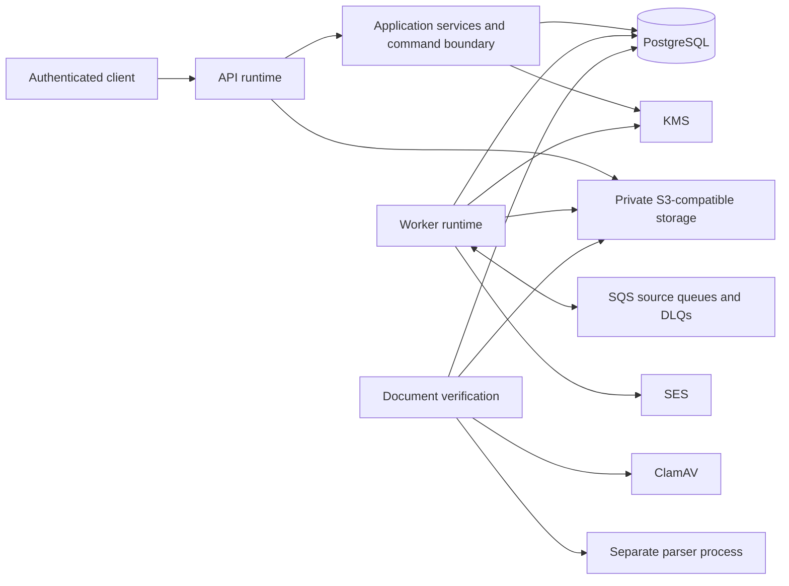
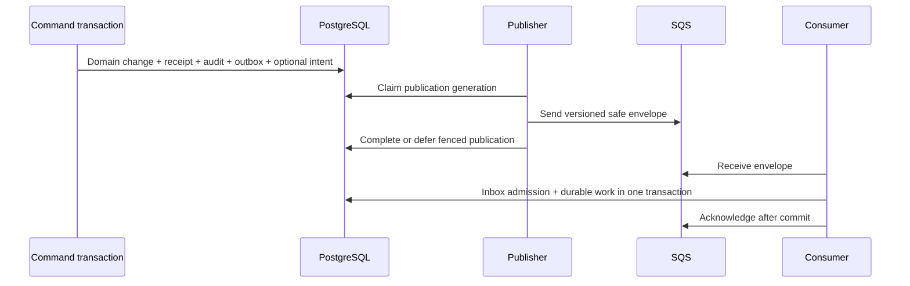

# Architecture

## System shape

Peoplecore is a Spring Boot modular monolith with HTTP and background-processing runtime modes. PostgreSQL holds business state, effective-dated access data, command receipts, append-only evidence and durable work. S3-compatible storage holds private document versions and generated CSV objects. SQS transports versioned event references; SES sends email; KMS encrypts invitation material; ClamAV and a separate parser process verify uploaded content.

The implementation uses Java 25, Spring MVC, Spring Security, JPA and JDBC repository adapters. Module boundaries are Java package and service boundaries inside one deployable and database, rather than separately deployed services. Dependency versions and packaging are defined in [build.gradle](build.gradle).

The diagram shows integration dependencies, not an assertion that all optional integrations are enabled. Conditional configuration controls their presence.

## Modules and data ownership

| Package | Owned behavior and state | Main collaboration |
|---|---|---|
| `identity` | Accounts, OIDC bindings, invitations, effective role grants, lifecycle access, verified notification destinations and authorization generations | Supplies current authority and narrow notification capabilities |
| `organization` | Employees, employment and assignment history, employee profile proposals and sealed revisions | Resolves current organizational context and employee ownership |
| `approval` | Effective approval-rule configuration and admission locking | Coordinates configuration changes with dependent operations |
| `attendance` | Schedule/calendar revisions, work context, clock events, corrections and routing/evidence | Resolves Jakarta-based occurrences and current reviewer eligibility |
| `leave` | Entitlement ledger, requests, cancellations, revisions, routing and decisions | Uses work context and entitlement accounting in lifecycle transitions |
| `document` | Upload metadata, verification attempts, immutable verified versions, holds, deletion and authenticated transfer | Exposes verified-version and content capabilities |
| `reimbursement` | Category revisions, claims, sealed evidence, assignments, decisions and payment records | Pins verified documents and checks current Finance/manager authority |
| `payslip` | Batch revisions, review state, publication history and current employee/month pointers | Pins verified payslip versions and exposes authorized employee downloads |
| `notification` | Frozen intents, durable deliveries, attempts, provider evidence and support operations | Uses domain resolvers and identity-owned capabilities |
| `reporting` | Report validation, scalar-query orchestration, consistent snapshots and response mapping | Calls domain-owned adapters and identity authorization |
| `reportexport` | Export jobs, generation leases, immutable candidates, download and cleanup | Uses scoped snapshots, fresh identity checks and private storage |
| `common`, `infrastructure` | Command receipts, audit, outbox/inbox, security filters and external adapters | Shared mechanisms without a common mutable business-workflow aggregate |

Repositories and persistence mapping live in domain-specific infrastructure adapters. Application services own authorization and lifecycle orchestration. API DTO mapping stays at the HTTP boundary where defined; some attendance and leave endpoints expose immutable application result records directly. [PersistenceConventionTest](src/test/java/id/mydev/peoplecore/architecture/PersistenceConventionTest.java) checks persistence dependency conventions.

## Runtime and database boundaries

[RuntimeEnvironmentPostProcessor](src/main/java/id/mydev/peoplecore/infrastructure/profile/RuntimeEnvironmentPostProcessor.java) accepts `peoplecore.runtime.role=api` or `worker`; `api` is the default. It forces servlet mode for the API and non-web mode for the worker. Both roles use the same application code and database contracts.

Automatic Flyway execution is disabled, including by the runtime environment processor. [MigrationRunner](src/main/java/id/mydev/peoplecore/infrastructure/migration/MigrationRunner.java) performs explicit migration. Schema evolution is defined in [migration SQL](src/main/resources/db/migration); [runtime provisioning SQL](local/postgres/provision-runtime.sql) grants application privileges separately from schema ownership.

[RuntimeDatabaseGuard](src/main/java/id/mydev/peoplecore/infrastructure/migration/RuntimeDatabaseGuard.java) rejects PostgreSQL runtime roles with elevated role capabilities, schema-object ownership, schema creation privileges or audit mutation privileges. This is a shared application role boundary, not per-module database isolation.

Base [application configuration](src/main/resources/application.yaml) disables Open Session in View. External calls and response streaming do not depend on a controller retaining an open persistence session.

## Authentication and authorization

[ApiSecurityConfig](src/main/java/id/mydev/peoplecore/common/security/ApiSecurityConfig.java) requires authentication for every HTTP request, configures Basic authentication and optionally a JWT resource server, and returns the common JSON error shape for authentication/authorization failures. The body-limit filter runs after authorization in the security chain. Correlation filtering attaches request correlation independently of domain payloads.

[SecurityJwtConfig](src/main/java/id/mydev/peoplecore/identity/infrastructure/config/SecurityJwtConfig.java) creates a decoder when a JWKS URI is configured and requires issuer and audience configuration. Validators check issuer, token timing, a present expiration claim and the expected audience. Resource authorization resolves application accounts from the authenticated identity and checks active status, access end time, binding and effective role assignments. Token role claims do not substitute for database checks.

[AccountAccessService](src/main/java/id/mydev/peoplecore/identity/application/service/AccountAccessService.java) and domain policies enforce employee ownership, organizational scope and reviewer eligibility. Administrative and support operations use explicit capabilities; [OperationAccessService](src/main/java/id/mydev/peoplecore/common/security/OperationAccessService.java) requires active organization-wide Operations authority rather than a unit-scoped grant.

## Command consistency and admission

[CommandExecutionService](src/main/java/id/mydev/peoplecore/common/command/CommandExecutionService.java) runs guarded commands at `READ_COMMITTED` isolation. It validates that the supplied actor matches the authenticated caller, obtains the configured admission mode, checks current access and serializes the logical command through the command coordinator. The coordinator's lock is keyed by actor, command type and idempotency key.

After locking, managed entities are flushed/cleared and access is checked again. A matching successful receipt is returned only after matching its request hash and rechecking replay access; reuse of a key with different content fails. Otherwise the domain action, successful receipt, audit event and outbox event commit in the same transaction. Failure rolls back the transaction. Optional outbox observers run before commit and can freeze notification intent alongside the originating change.

[ProfileAdmissionGuard](src/main/java/id/mydev/peoplecore/approval/application/admission/ProfileAdmissionGuard.java) defines shared/exclusive admission. Identity, organization and effective-rule changes take exclusive admission; dependent workflow commands, document operations and export creation take shared admission. Fine-grained domain locks and version checks remain necessary inside that boundary.

Database constraints and triggers protect immutable revisions, assignment provenance, append-only audit/evidence and valid lifecycle transitions. These protections complement application checks and apply to direct SQL writers as well.

## Business state and private content

Profile changes, attendance corrections, leave requests/cancellations and reimbursement claims use domain-specific lifecycle services. Submitted revisions and decisions are durable evidence; draft edits do not rewrite sealed evidence. Assignments preserve their original references, while acting on work requires current eligibility. Configuration and assignment history are effective-dated rather than overwritten as one current value.

[AttendanceRecordingService](src/main/java/id/mydev/peoplecore/attendance/application/service/AttendanceRecordingService.java) resolves work occurrences in `Asia/Jakarta`. [LeaveWorkflowService](src/main/java/id/mydev/peoplecore/leave/application/service/LeaveWorkflowService.java) coordinates transitions with entitlement accounting. [ReimbursementSubmissionService](src/main/java/id/mydev/peoplecore/reimbursement/application/service/ReimbursementSubmissionService.java) seals submitted revisions and evidence; payment APIs record payment facts rather than initiating bank transfers.

[PayslipService](src/main/java/id/mydev/peoplecore/payslip/application/PayslipService.java) checks every employee in a batch against current HR or Finance scope. Publication retains immutable history and changes the current employee/month pointer transactionally. It does not calculate payroll. Employee content access resolves permitted published documents through the private-content boundary.

[DocumentUploadService](src/main/java/id/mydev/peoplecore/document/application/service/DocumentUploadService.java) separates metadata creation, upload reservation and finalization. Verification checks bounded bytes and hashes, supported signatures, malware scanning and format parsing. [DocumentContentInspector](src/main/java/id/mydev/peoplecore/document/application/service/DocumentContentInspector.java) caps content at 10 MiB. Verification leases and completion fences prevent stale workers from promoting content.

Parser code is built separately from the main source set and invoked through the document parsing boundary. [DocumentVerificationConfig](src/main/java/id/mydev/peoplecore/document/infrastructure/config/DocumentVerificationConfig.java) creates the verification worker only when storage, scanner readiness, format verification and timing properties are available. Missing integration configuration does not imply content is verified.

Legal holds and deletion state live in PostgreSQL. Physical purge occurs separately and records completion; incomplete copy outcomes prevent premature object removal. [RevocableDocumentTransfer](src/main/java/id/mydev/peoplecore/document/application/service/RevocableDocumentTransfer.java) bounds concurrent transfers, rechecks authorization during streaming and closes the source on cancellation. Application cancellation does not prove a particular proxy's buffering or disconnect behavior.

## Durable event transport

[EventRoutingPolicy](src/main/java/id/mydev/peoplecore/common/outbox/EventRoutingPolicy.java) explicitly classifies metadata-only events and supported asynchronous events. [EventDispatchService](src/main/java/id/mydev/peoplecore/common/outbox/EventDispatchService.java) claims fenced publication in a short transaction, performs SQS I/O outside that transaction, then records the outcome under the claim generation. A crash after send can cause duplicate publication.

Metadata-only events are marked ignored. Known asynchronous events with unavailable handlers remain retryable. Unsupported, future-dated, wrong-consumer or over-horizon envelopes are rejected/quarantined. [EventIngestionService](src/main/java/id/mydev/peoplecore/common/outbox/EventIngestionService.java) enforces a 14-day replay horizon and commits inbox admission with handler materialization before acknowledgement. Inbox uniqueness is scoped by consumer and event ID.

[SqsEventTransport](src/main/java/id/mydev/peoplecore/infrastructure/queue/SqsEventTransport.java) validates source/DLQ topology. [EventTransportConfig](src/main/java/id/mydev/peoplecore/infrastructure/queue/EventTransportConfig.java) enables transport only for an explicit worker role with events enabled. HTTPS endpoints are required except local loopback HTTP. Disabling retention validation is restricted to a local-profile loopback emulator; redrive validation remains active.

Replay is an explicit reasoned Operations action on retained event identity. It republishes transport work without re-executing the original business command. Inbox evidence, replay limits and quarantine remain relevant on replay; broker delivery is not an exactly-once business or email guarantee.

## Notification delivery and acceptance

Origin-transaction observers freeze intended employee/account, template, assignment context and verified destination identity/version. [NotificationIntentService](src/main/java/id/mydev/peoplecore/notification/application/NotificationIntentService.java) materializes durable delivery work from those intents. Domain resolvers preserve original recipient references and recheck current eligibility instead of retargeting an old event to a new reviewer.

[NotificationTransactions](src/main/java/id/mydev/peoplecore/notification/application/NotificationTransactions.java) claims an attempt, locks/rechecks recipient eligibility and pinned destination, and suppresses obsolete work. For invitations it obtains identity-owned material and verifies validity before preparing a message. [NotificationWorker](src/main/java/id/mydev/peoplecore/notification/application/NotificationWorker.java) calls the provider outside preparation/completion transactions. Network uncertainty produces `UNKNOWN`; it is not automatically treated as a safe retry.

Identity owns verified destinations and invitation encryption. [KmsInvitationCipher](src/main/java/id/mydev/peoplecore/identity/infrastructure/delivery/KmsInvitationCipher.java) binds encryption context to invitation/destination identity. Immutable source rows retain the destination reference while ciphertext can be disposed. Activation secrets are not normal event payloads; invitation message diagnostics are redacted. Ordinary messages contain event references and an authenticated application link, without attachments or business record contents.

[SesFeedbackService](src/main/java/id/mydev/peoplecore/notification/application/SesFeedbackService.java) parses bounded feedback from the configured SNS topic through a dedicated queue consumer. [SesFeedbackWorker](src/main/java/id/mydev/peoplecore/notification/infrastructure/provider/SesFeedbackWorker.java) validates queue source policy. Repository feedback correlates delivery, attempt and provider message identity; stale-generation evidence cannot replace current delivery state.

[NotificationAcceptance](src/main/java/id/mydev/peoplecore/notification/application/NotificationAcceptance.java) is shared by synchronous completion, trusted feedback and Operations reconciliation. Lock order is shared admission, exact identity-owned invitation context, then delivery. Mapping to invitation `SENT` requires persisted `ACCEPTED`/`DELIVERED`, matching generation and current attempt UUID. Historical acceptance can be recorded after expiry, revocation, address change or ciphertext disposal; this changes the delivery summary without reactivating an invitation or decrypting its secret.

[NotificationSupportService](src/main/java/id/mydev/peoplecore/notification/application/NotificationSupportService.java) requires Operations authority, a reason, idempotency and expected-version checks. Retrying an uncertain send requires explicit duplicate acknowledgement. Destination replacement creates linked delivery identity rather than editing the frozen recipient; invitations require authorized reissue. Evidence and support history are append-only.

Failure attention commits with the triggering delivery transition, including current-attempt SES failure feedback, expired sending leases and missing destinations. Stable attention identity deduplicates each event/delivery generation/code. [The alert migration](src/main/resources/db/migration/V34__notification_attention_alerts.sql) queues existing attention and previously unrecorded failed/uncertain deliveries without mutating the append-only evidence.

[NotificationAttentionWorker](src/main/java/id/mydev/peoplecore/notification/application/NotificationAttentionWorker.java) claims durable alert work in a short transaction, sends outside that transaction and records acknowledgment under the lease generation. Unacknowledged work remains visible without an age cutoff and retries after 30 seconds. A crashed or uncertain sender can repeat delivery with the same attention identity; the receiver must honor its idempotency key. [WebhookNotificationAttentionSink](src/main/java/id/mydev/peoplecore/notification/infrastructure/provider/WebhookNotificationAttentionSink.java) sends only safe references, code and creation time through authenticated HTTPS, or loopback HTTP, with a two-second timeout and no redirects. Provider email failure does not require SES to send its own alert. [NotificationAttentionConfig](src/main/java/id/mydev/peoplecore/notification/infrastructure/config/NotificationAttentionConfig.java) polls every five seconds when explicitly enabled in worker mode; send/feedback workers require this alert component before starting. These bounds describe configured local mechanisms rather than measured production alert capacity.

## Reports and aggregate scope

[ScopedReportService](src/main/java/id/mydev/peoplecore/reporting/application/ScopedReportService.java) orchestrates domain-owned scalar queries inside a read-only `REPEATABLE_READ` snapshot. Authorization, data-as-of time, authorization generation and the next effective boundary are captured with that snapshot. Reports query authoritative domain tables rather than event-maintained projections.

The report catalog covers attendance, request status, leave balances, reimbursements, payslip status and safe audit metadata. Date-range reports require an explicit end-exclusive range of at most 31 days; balances select one year and payslip status one month. Interactive output is capped at 10,000 rows and export snapshots at 50,000. Exceeding the cap fails rather than silently truncating. SQL uses bound filters, explicit columns and deadlines. The employee model has no employee-name field; affected outputs use an empty name and unavailable-column metadata.

[ReportAuthorizationService](src/main/java/id/mydev/peoplecore/identity/application/service/ReportAuthorizationService.java) checks active identity and report-specific role/employee/unit access. Domain adapters add row-specific scope, including self/reviewer access where applicable. Audit output projects event/actor references, action, domain, resource reference, time and reason-presence; it does not return raw details or reason text.

[JdbcAuditReportQuery](src/main/java/id/mydev/peoplecore/common/audit/infrastructure/persistence/JdbcAuditReportQuery.java) resolves aggregate owners explicitly. The caller must hold current qualifying HR or Finance authority for every employee in a payslip batch's current revision; an authorized item cannot admit the whole event. Employee/unit/resource filters do not shrink that authorization set. Global Operations has an explicit override; a scoped Operations role does not. The rule uses current revision subjects and current organizational scope.

## Export publication, download and cleanup

[ReportExportService](src/main/java/id/mydev/peoplecore/reportexport/application/ReportExportService.java) persists the requester and canonical request, enforces at most two unfinished jobs per requester, and sets 24-hour retention. Ownership is necessary but does not replace fresh report authorization.

[ReportExportWorker](src/main/java/id/mydev/peoplecore/reportexport/application/ReportExportWorker.java) claims a generation lease, obtains a scoped snapshot, renders CSV and registers an immutable candidate with byte size and SHA-256 digest. Object upload occurs outside the database transaction. Publication requires a completed candidate, current lease, active requester authority, matching authorization generation, an unpassed effective boundary and a snapshot no older than 15 minutes. Generation processing has a 120-second budget.

[ExportArtifactStorage](src/main/java/id/mydev/peoplecore/reportexport/infrastructure/storage/ExportArtifactStorage.java) stores private immutable candidates; CSV rendering escapes spreadsheet-formula prefixes. Download uses authenticated application streaming with repeated fresh authorization and a deadline bounded by expiry/effective changes. It does not issue a public object-storage download URL.

[AuthorizationFenceService](src/main/java/id/mydev/peoplecore/identity/application/service/AuthorizationFenceService.java) exposes generation and upcoming effective boundaries. [Authorization fence triggers](src/main/resources/db/migration/V33__authorization_export_fences.sql) advance the global generation for identity, assignment, work-context and workflow mutations that can change report authority. Generation values are equality tokens, not a promise of consecutive application-visible increments. The global fence invalidates conservatively across affected jobs.

Uncertain uploads are reconciled by expected immutable object metadata before completion is recorded. Cleanup selects candidates whose lifecycle permits deletion, removes storage objects and records completion separately. Failed deletion remains pending. Lease generation prevents an obsolete worker from publishing over newer work.

## Configuration and operational boundaries

Events, notification core, notification sending, SES feedback, reports and exports each have explicit enablement/configuration boundaries. [NotificationCoreConfig](src/main/java/id/mydev/peoplecore/notification/infrastructure/config/NotificationCoreConfig.java) requires KMS region/key configuration when enabled. [NotificationSendConfig](src/main/java/id/mydev/peoplecore/notification/infrastructure/config/NotificationSendConfig.java) starts sending only in worker mode with both core and send flags enabled. Feedback also requires events and feedback flags. [ReportExportSchedulingConfig](src/main/java/id/mydev/peoplecore/reportexport/infrastructure/config/ReportExportSchedulingConfig.java) requires exports, worker enablement and worker runtime for polling.

Document and export storage configuration reject non-HTTPS remote endpoints and configure bounded provider calls without SDK retries. [ServiceRecoveryGate](src/main/java/id/mydev/peoplecore/infrastructure/recovery/ServiceRecoveryGate.java) unifies recovery isolation across `peoplecore.recovery.isolated` and open [V35 service recovery incidents](src/main/resources/db/migration/V35__service_recovery_and_observability.sql), fencing `CommandExecutionService`, document/payslip/export content streams, document verification and deletion schedulers, and event/notification/export workers. [ServiceRecoveryService](src/main/java/id/mydev/peoplecore/infrastructure/recovery/ServiceRecoveryService.java), [OperationsObservabilityController](src/main/java/id/mydev/peoplecore/infrastructure/recovery/OperationsObservabilityController.java), and [ServiceRecoveryController](src/main/java/id/mydev/peoplecore/infrastructure/recovery/ServiceRecoveryController.java) expose database backlog-age observability (`GET /api/v1/operations/health-summary`), post-restore identity/invitation reconciliation, storage checksum inventory with owned exceptions, and three-owner (`HR_ADMIN`, `FINANCE_PAYROLL`, `SYSTEM_ADMIN`) reopening consensus. Application checks do not independently establish deployed IAM/key-policy correctness, bucket access controls, provider onboarding, proxy cancellation or service availability.

The implementation emits structured identifiers and error classes for asynchronous failures and exposes durable quarantine, delivery evidence, attention and export state. Configured worker limits do not establish production capacity. Queue, provider, scanner, parser and storage availability remain external dependencies.

## Executable consistency evidence

Source-level architecture conventions are checked by [PersistenceConventionTest](src/test/java/id/mydev/peoplecore/architecture/PersistenceConventionTest.java). PostgreSQL fixtures exercise constraints and actual query predicates; unit/HTTP tests cover validation and public behavior. Representative persistence scenarios include [event transport](src/test/java/id/mydev/peoplecore/common/outbox/EventTransportPostgresTest.java), [notification acceptance](src/test/java/id/mydev/peoplecore/notification/infrastructure/persistence/InvitationAcceptancePostgresTest.java), [whole-batch audit scope](src/test/java/id/mydev/peoplecore/payslip/PayslipBatchAuditScopePostgresTest.java), [scoped reports](src/test/java/id/mydev/peoplecore/reporting/ScopedReportsPostgresTest.java) and [export authorization](src/test/java/id/mydev/peoplecore/reportexport/application/ReportExportAuthorizationPostgresTest.java).

These are executable coverage locations, not a claim that integrations ran in a particular environment. Build checks and separate PostgreSQL execution are defined in [build.gradle](build.gradle).
